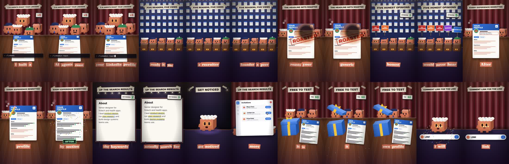

# Skill: diorama-promo-video

Skill Claude untuk membuat video vertikal 9:16 (Reels / TikTok / Shorts) bergaya
"miniatur diorama": karakter balok tanah liat di panggung kecil, banner kertas berselotip,
counter skor, caption kata-per-kata di potongan kertas, film grain, dan CTA "komen LINK".



## Isi
- `diorama-promo-video/SKILL.md` — instruksi untuk Claude (alur: brief → naskah → build → preview → render)
- `assets/template/` — proyek Remotion; semua isi video diatur dari `src/video.json`
- `scripts/new_video.sh` — buat proyek baru dari template
- `scripts/preview_sheet.mjs` — satu gambar berisi semua adegan (cek cepat sebelum render)
- `scripts/word_timings.py` — sinkron caption dengan rekaman voiceover (faster-whisper)
- `scripts/render.sh` — render MP4 (otomatis memakai Chrome lokal bila perlu)
- `references/` — panduan gaya & referensi semua tipe adegan

## Pakai manual
```bash
bash diorama-promo-video/scripts/new_video.sh ./video-saya
# edit ./video-saya/src/video.json
node diorama-promo-video/scripts/preview_sheet.mjs ./video-saya
bash diorama-promo-video/scripts/render.sh ./video-saya out/video.mp4
```
Butuh Node.js 20+ dan ffmpeg.
